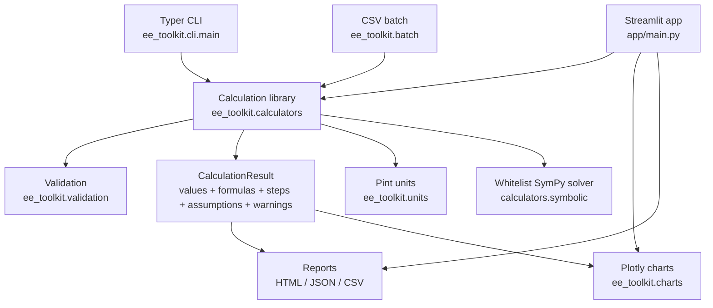

# Architecture

Design rules: one validated calculation engine powers the UI, CLI, and batch
paths (no duplicated formulas); calculators never import Streamlit or Typer;
all results carry their formulas, steps, assumptions, and warnings so every
number is auditable. Internal arithmetic is full float precision — rounding
happens only at presentation, except money, which uses `Decimal` quantised
to cents (ROUND_HALF_UP).
